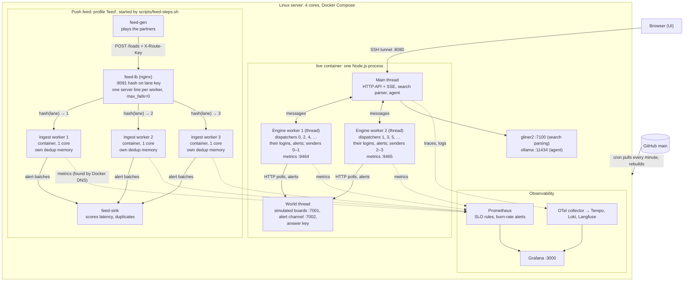

# Load Radar at 1000x

A saved-search alert engine for truck dispatchers, built and load-tested on simulated load boards, to answer one question with measurements: **what breaks first at 1000x, and how do you fix it?** Status: built and running continuously on a server (section 8 lists what's built and what isn't).

> New to the project? Start with [GUIDE.md](GUIDE.md). This is the **high-level design** (problem, constraints, parts, why); the **low-level design** (types, state, APIs, algorithms, tests) is in [LLD.md](LLD.md).

**Guiding rule:** the hot path has **no shared store** — each stage keeps its state in memory, owned by one worker, partitioned by key. A shared store or log is added only when a measurement asks for it (LLD §12).

---

## 1. The problem in one page

A *broker* posts a *load* on a *load board* (DAT, Truckstop, broker portals); a *carrier*'s *dispatcher* keeps its trucks busy by finding loads. Dispatchers search every board by hand and refresh all day — good loads are gone in minutes. **The product:** the dispatcher saves a search once; the system watches every board and alerts the moment a matching load appears.

**What the customer needs**, in priority order:

| Need | Measured as |
| --- | --- |
| Never get my board account banned | bans = 0 |
| Fast | seconds from *broker posted* to *alert on my phone* |
| Complete | share of matching loads never alerted |
| Quiet | duplicate alerts; alerts for loads already taken |

**Why it's a scaling problem.** Each customer's searches run on their own board login:

```
requests/s = dispatchers × board logins each × requests per login per second
   measured:   2,000     ×       1.8        ×   ~0.52                       = 1,882/s   (SLO.md, 1×)
   5,000 dispatchers                                                       ≈ 4,700/s
   × 1000 growth (5 million dispatchers)                                   ≈ 4.7 million/s
```

One engine worker serves ~2,000–3,000 requests/s within the SLOs (SLO.md). 5,000 dispatchers needs 2–3 workers on this 4-core server; 4.7 million/s would need ~2,000 workers. Moving volume to push feeds (§3.5) is what bends that curve. At 2,000 dispatchers, board requests outnumber new loads about 1,600 to 1 — **the work is in polling and deduplicating, not in the freight itself.**

## 2. Constraints that shape the design

| Constraint | Evidence | What it forces |
| --- | --- | --- |
| One login per person; no sharing, no scraping tools | [DAT](https://www.dat.com/blog/why-dat-doesnt-allow-login-sharing-or-data-scraping-extensions): "Each DAT login is for one person" | A result fetched with customer A's login can **only alert customer A** |
| Different customers see different loads | Broker portals only show loads to approved carriers | Every posting carries **who is allowed to see it** |
| Each login has a request budget; abuse gets it banned | Board behavior (simulated) | The scheduler spends a per-login budget; a ban is the worst outcome |
| Alerts go to dispatchers on the web, through a channel with limits: ~30 msg/s/sender, ~1 msg/s/dispatcher | Simulated, set like typical messaging APIs | 5,000 alerts for one hot load take ~170 s from one sender |
| ~52% of board rows are duplicates; 30% have no rate | Measured on a public board, built into the simulator (`sim/ASSUMPTIONS.md`) | Two-stage dedup; an explicit no-rate policy |
| LLMs are slow (~1 s) and cost money | General | No LLM per posting; only when a search is created |

## 3. System design and architecture

Two views of the same system. **System design** is the logic: what happens to a posting. **Architecture** is what actually runs, where.

### System design: what happens and why

```mermaid
flowchart LR
  subgraph CP["Control plane: a dispatcher saves a search (rare, accuracy matters)"]
    U[Dispatcher] --> PARSE["Understand the search<br/>rules first, a model only if unsure;<br/>ask instead of guessing"]
    PARSE --> SEARCHES[(Saved searches)]
    SEARCHES --> PLAN["Plan the polling<br/>merge a dispatcher's overlapping searches;<br/>budget per login, busy lanes more often (√ rule)"]
    SEARCHES --> INDEX["Match index<br/>area × equipment → searches"]
  end

  subgraph POLL["Polling lane: boards that need each customer's own login<br/>split by DISPATCHER: everything about one dispatcher in one place, nothing shared"]
    SCHED["Decide when to check<br/>stay inside each login's budget;<br/>one request at a time per login; back off on 'slow down'"]
    FETCH["Fetch with the customer's login"]
    N1["Normalize<br/>one format; who may see it"]
    D1["Dedup<br/>same id, then 'same load?' model"]
    M1["Match<br/>only that customer's searches"]
  end

  subgraph PUSH["Push lane: partners send each load once, for everyone<br/>split by LOAD: every copy of a load to the same place, so dedup sees them all"]
    ROUTE["Route by lane key<br/>origin, destination, pickup date, equipment"]
    N2["Normalize"]
    D2["Dedup"]
    M2["Match<br/>every customer's searches"]
  end

  subgraph OUT["Alerts"]
    Q["Queue<br/>one alert per dispatcher per load;<br/>freshest first when behind, drop stale"]
    SEND["Deliver<br/>within each channel's limits; digests"]
  end

  PLAN --> SCHED --> FETCH --> N1 --> D1 --> M1 --> Q
  INDEX --> M1
  INDEX --> M2
  PARTNERS[Partners] --> ROUTE --> N2 --> D2 --> M2 --> Q
  Q --> SEND --> PHONE[Dispatcher]
  PHONE -->|"Should I take it?"| DECIDE["Decide<br/>a model reads the broker's comments;<br/>code applies the dispatch policy"]
```



### Architecture: what runs where



The number of workers is a setting (`LIVE_ENGINE_WORKERS`, `--scale feed-ingest`); shown here with 2 engine workers and 3 ingest workers. The default live service runs the engine on the main thread and no push feed.

### 3.0 Live mode: the same pipeline, running continuously

One container, several threads: the simulated world runs on its own thread/core so the engine never shares a core with the boards it polls; `--engine-workers N` splits the engine itself across N threads.

```
┌─ live container: one Node process, 2 + N threads ─────────────────────────────────────────────┐
│ WORLD THREAD  live/world-worker.ts — new loads forever (Poisson), reposts/cross-posts/co-brokers │
│   ├─► boards-sim :7001  per-login budgets, 429 + Retry-After, bans                              │
│   ├─► alert channel :7002  30 msg/s/sender, 1 msg/s/dispatcher (sims/telegram-sim.ts)            │
│   └─► live/score.ts     answer key built as each load is born; scores every delivery             │
│ ENGINE WORKER i  live/engine-worker.ts — dispatchers i, i+N, i+2N, …; own logins, rate limits,   │
│   alerted memory, senders, metrics :9464+i: scheduler─►poll─►normalize─►dedup─►match─►queue─►notify│
│ MAIN THREAD  live/server.ts — HTTP+SSE API; search parser (─► gliner2 :7100); agent (─► ollama)  │
└─────────────────────────────────────────────────────────────────────────────────────────────────┘
   ui/ (React, static) ◄── browser, through an SSH tunnel on :8080

Push feed (profile "feed", scripts/feed-steps.sh): feed-gen ─► feed-lb (nginx :8091, hash on
  X-Route-Key; one server line per worker, max_fails=0) ─► N ingest workers (own dedup memory) ─► feed-sink

Telemetry: OTLP ─► otel-collector ─► tempo (traces) / loki (logs) / langfuse (model calls);
  prometheus scrapes live + ingest workers (Docker DNS) → error budgets, burn-rate alerts; grafana :3000.
```

Speed is adjustable live without restarting. Saving/removing a search rebuilds the matcher index and polling plans (LLD §6.10).

### 3.1 Control plane: creating a search (rare, accuracy matters)

**Search parser:** rules first (town list, `$3.40`, `DH 100`, equipment words); an LLM (structured JSON) only when rules aren't confident; the user confirms before saving — a wrong filter silently misses loads. Measured: 98% of fields correct on a 40-example eval (rules alone 95%, LLM alone 60%; `ml/parser/RESULTS.md`).

**Plan compiler:** on any search change, merges a dispatcher's overlapping searches into the fewest board queries and rebuilds the matcher index.

### 3.2 Sources: two lanes

| Lane | Examples | Fetching | Who can be alerted |
| --- | --- | --- | --- |
| **Gated** | DAT, Truckstop, broker portals | with each customer's own login, within budget | only that customer |
| **Shared** | direct broker posts, partner feeds | once for everyone | every matching search |

Polling the gated lane is what explodes at scale; moving volume into the shared lane through partnerships is the strongest 1000x lever — a business fix, not a server fix.

### 3.3 Data plane: every posting (hot path)

- **Scheduler:** min-heap of (login, query) by next-check time; token-bucket budget per login; square-root allocation (busy lanes checked more); jitter; backoff and a circuit breaker before a ban.
- **Normalizer:** one adapter per board → one `Load` schema (board formats differ; e.g. Truckstop's 14-character names are resolved by prefix), with coordinates, normalized equipment, and who may see it.
- **Dedup:** exact `(board, id)` + content hash catches refreshes; a same-load classifier (rate, timing, broker, town-name similarity) catches reposts, cross-posts and co-brokered copies, without merging recurring loads on different pickup days.
- **Matcher:** index `(geohash cell, equipment, pickup date)` → candidate searches, then exact filters (deadhead, destination, rate, entitlement). No-rate loads (30%) still match, flagged "call to negotiate."
- **Alert queue → notifier:** one alert per (dispatcher, load), oldest-first while keeping up, freshest-first and dropped after 10 min when behind; idempotency key `(user, load)`; token buckets (~30 msg/s/sender, ~1 msg/s/dispatcher) with digests.

*Example:* a Chicago→Atlanta load posted at 9:02:10 is matched and alerted by 9:02:16 — 6 s end to end; a later cross-post of the same load is deduped, no second alert.

### 3.5 Scaling out: engine workers and the push feed (measured, SLO.md)

**Polling lane:** `--engine-workers N` shards dispatchers — logins, rate limits, alerted memory, senders — across N threads; nothing shared, no load balancer needed. 2 workers give 1.77× the board requests of 1 (3,745 → 6,617/s).

**Push lane:** nginx hashes postings on a lane key (origin state, destination state, pickup date, equipment) across N ingest workers, so every copy of a load lands on the worker that holds its dedup memory. Throughput 2,050 → 3,346 postings/s from 1 to 3 workers; duplicates 1.7–2.7% with hash routing. One `server` line per worker and `max_fails=0` stop nginx from re-routing a worker's loads after one failed request.

## 4. Decisions, alternatives and trade-offs

The ~10–15 that matter most. [GUIDE.md §6](GUIDE.md#6-technology-and-why) has a plain-language summary; the rest of the implementation choices are in LLD.md.

| # | Decision | Why | Alternatives considered | Trade-off we accept |
| --- | --- | --- | --- | --- |
| 1 | **Poll gated boards with each customer's own login**; move volume to shared/partner feeds where possible | Boards require per-user logins; customers see different loads; shared feeds are the only way off per-login polling at 1000x | One shared fetch cached for everyone; polling only | Volume scales with customers × searches × boards; shared feeds need partnerships (a business task) |
| 2 | **Per-login scheduling:** merge overlapping searches into fewer queries, square-root budget allocation, one request in flight per login, backoff + circuit breaker before a ban | Minimizes discovery delay under a fixed budget; a suspended login is the worst outcome | Equal intervals, one query per search; queue every poll; a global concurrency cap only | More local filtering CPU; slower discovery while a login is paused |
| 3 | **Two-stage dedup:** exact id + hash, then a logistic-regression same-load classifier (18 features, threshold at precision ≥0.995) | Exact ids catch refreshes; only features catch reposts, cross-posts, co-brokers | Hand-written rule (92.7% recall); LightGBM (99.9% recall, needs a tree runtime) | Needs labeled pairs; tuned to favor duplicates over hidden loads |
| 4 | **Entitlement on every posting** (`visibleTo`) | A load found with customer A's login may only alert customer A | Alert everyone who matches | Measured without it: ~244 users/load, 5.7M alerts/day |
| 5 | **Matcher index on geohash level 3**, then exact distance checks | Measured 6–20 candidate cells per search vs 99–474 at level 4 | DB range query on lat/lon; R-tree; level 4 | Some false candidates, removed by exact checks |
| 6 | **State in memory, partitioned by key; no shared store on the hot path** | No network call per load; atomic updates for free | Redis between every stage; a stream from day one | A crash loses all in-memory state (no snapshot yet); a log (Kafka) is added only on a measured trigger (LLD §12) |
| 7 | **LLM only on the cold path** (search parsing), behind rules, with confirmation; "should I take it" = a model reading comments, code applying the policy, on local models (Ollama/Qwen) | ~1 s/call is fine once per search, not per posting; measured 88–100% accuracy vs 21–42% for a model making the whole decision | LLM per posting; a full tool-calling agent; a hosted API | Messy searches need confirmation; local models are slower/weaker than a hosted API |
| 8 | **Engine sharded by dispatcher** (`--engine-workers N` threads) | Each worker owns its dispatchers' logins, state and alerts; nothing shared, no load balancer needed | Shard by board; one process per worker | Measured 1.77× requests with 2 workers (3,745 → 6,617/s); ~6,100–6,600/s is this 4-core machine's ceiling |
| 9 | **Push feed: nginx hashing on a lane key**; one `server` line per worker, `max_fails=0`, 65 s worker keep-alive | Dedup memory is per worker; every copy of a load must reach the same one; nginx's defaults would re-route a worker's loads after one failed request | Round robin (copies reach different workers; measured 43% duplicate alerts vs 2% hashed); a shared dedup store | Uneven load if a few lanes are hot; production needs an edge tier or Kafka key to compute the lane key |
| 10 | **Live mode as one container, several threads** (world, engine, main) | The engine must not share a core with the boards it polls; one clock serves both | One thread; separate processes per simulator | Message passing between threads; still one process to restart |

## 5. What breaks first at 1000x (current view, measured where available)

**Baseline (measured):** at 1×, 300 dispatchers, 30 h — 100% of alerts within 60 s (p50 2.7 s, p99 9.3 s), 0 bans/429s across 33M board requests, 0.03% duplicate alerts, 96–97% completeness. At 30× speed, under the overload rules: 83.7% within 60 s, 87.9% completeness, still 0 bans/429s.

| # | Breaks | Why | Fix |
| --- | --- | --- | --- |
| 1 | **Login budgets** (outside our servers) | Per-login rate limits cap check frequency long before our CPU does | Merge queries better; adaptive intervals; **move volume to shared and partner feeds** |
| 2 | **Alert delivery** | A hot load matching thousands of users means minutes of queueing at 30 msg/s | Prioritize by load age; digests; several senders; in-app push as the main channel |
| 3 | **HTTP pools, then one CPU core** | Undersized pools make data stale with no errors; measured: one engine thread holds all SLOs to 2,000 dispatchers, breaks the speed SLO at 5,000 | Size pools by Little's law; worker threads partitioned by login, then more machines |
| 4 | **In-memory state and GC** | Dedup and alerted sets grow with postings × logins; big heaps mean long GC pauses | Compact entries, drop old buckets, partition across workers and machines |
| 5 | **Matcher on hot cells** | Chicago or Dallas vans concentrate shared-feed fan-out | Shard by `(cell, equipment)`; dedicated workers for hot cells |
| 6 | **Login storage** (security, not throughput) | Thousands of customers' board passwords are the most sensitive data in the system | Encryption keys in a KMS, per-tenant isolation, audit logs |

### Scaling path

| Stage | Example size | Runs as | Next limit | Response |
| --- | --- | --- | --- | --- |
| Today (measured, SLO.md) | 2,000 dispatchers within all SLOs on one engine thread; speed SLO breaks at 5,000. 2 engine workers: 1.77× (6,617/s) | Engine workers (threads), world on its own thread | The 4-core machine | Workers on more machines, with leases for login ownership |
| 10x | ~50,000 customers | + worker threads partitioned by login | One CPU core (JSON parsing) | Threads, then processes |
| 100x | ~500,000 customers | Several machines, each owning partitions (login / cell / user) | Alert delivery; memory per machine | More senders, push as a second channel; compact state |
| 1000x | ~5M customers | Many machines, partitions connected by Kafka; snapshots + log replay | Login budgets as a business limit | Shared and partner feeds wherever possible |

No central store sits on the hot path at any stage; LLD §12 lists the measured triggers for adding one.

## 6. Observability

Full plan (RED/USE metrics, sampling, dashboards, runbooks, load-test protocol) is in [OBSERVABILITY.md](OBSERVABILITY.md); SLO targets and error budgets are in [SLO.md](SLO.md).

**Cost:** lite metrics + our own 1% head sampling + one span per posting adds **+1.0% CPU** (pinned Linux core). Default OpenTelemetry costs +18% at 1% sampling and +41% at 100%, with 3% span loss.

**SLOs** (1-hour rolling error budget, multi-window burn-rate alerts, `ops/prometheus-rules.yml`):

| SLI | Target |
| --- | --- |
| Fast | 99% of alerts within 60 s of posting |
| Complete | 99% of matching loads (on board 5+ min) get alerted |
| Friendly | 0 banned logins; under 1% of requests get a 429 |

The simulator's answer key scores latency, misses and duplicates exactly — a production system can only estimate these.

## 7. Test setup

| Piece | Status | What it does |
| --- | --- | --- |
| **Data generator** (`sim/gen.ts`) | Done | Realistic loads/postings in 4 board formats, users, searches, an answer key; `sim/validate.ts` checks 16 metrics |
| **Board + alert simulators** | Done | Serves postings per login, enforces budgets (429s, bans), removes taken loads |
| **Scorer** (`scorer/score.ts`, `live/score.ts`) | Done | Compares delivered alerts to the answer key: latency, misses, duplicates, stale alerts |
| **Load test runs** | Informal | Live mode's speed/volume/burst controls stand in for a step-load harness; a formal one is not built |

## 8. Status

Built and running: the data generator, board and alert-channel simulators, scheduler, pollers, normalizer, dedup (exact id + trained classifier), matcher, alert queue, notifier, search parser (rules + GLiNER2/LLM fallback), the "should I take it" agent, observability (metrics, traces, logs, LLM call log), the Grafana dashboard, the scorer (batch and live), live mode (`live/`, `ui/`), and continuous deployment to the server.

**Not built:** workers on separate machines; leases so a failed worker's dispatchers move; snapshots / crash recovery (a restart loses all in-memory state); Grafana panels for the push feed and per engine worker; alerting on failed deploys; a slow-burn SLO alert; a formal step-load harness; parser exclusions ("anywhere but NY").

**Stack:** TypeScript on Node. One engine process with in-memory, partitioned state. Searches and credentials come from flat files, not a database: `searches.ndjson` in batch mode, a JSON file per user in live mode (volume `live_state`). No Redis or Kafka until a measured trigger (LLD §12). LLD §13 describes where a real database (Postgres) and snapshot/log replay would go in production.

## 9. Risks

- **Laptop numbers aren't production numbers.** Report which stage saturates first and how the system degrades, not absolute capacity.
- **Results are only as good as the simulator.** Every assumption is listed in `sim/ASSUMPTIONS.md` so it can be challenged.

## 10. Open questions (answers would change the design)

- Is a product like this bound by polling on customer logins, or can it get push feeds from boards and brokers?
- What post-to-alert latency do dispatchers actually need, and how often do real systems miss matches?
- What do board partnerships allow that a normal login doesn't (higher limits, shared feeds)?
- Which channel do dispatchers act on fastest: web, mobile push or SMS?
