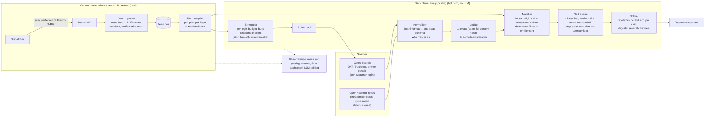

# Load Radar at 1000x

A saved-search alert engine for truck dispatchers, built and load-tested on simulated load boards, to answer one question with measurements: **what breaks first at 1000x, and how do you fix it?**

Status: updated 2026-11-04. Originally time-boxed to 2 days on one laptop; most of it is now built and running continuously on a server (README.md §8 has the exact built-vs-designed breakdown).

This is the **high-level design**: the problem, the constraints, the parts and why each exists. The **low-level design** (types, in-memory state, APIs, algorithms, failure handling, tests) is in [LLD.md](LLD.md).

**Guiding rule:** connection pool limits and N+1 queries usually bite long before the database does. Fix those first, then talk Redis. So the hot path has **no shared store**: each stage keeps its state in memory, owned by one worker and partitioned by key. A shared store or log is added only when a measurement asks for it (LLD section 12).

---

## 1. The problem in one page

**The industry.** A *shipper* has goods to move. A *broker* takes the job and posts it as a *load* on a *load board* (DAT is the biggest, with ~500K load posts a day; then Truckstop, then broker portals). A *carrier* owns trucks. Its *dispatcher* keeps the trucks busy by finding loads.

**The pain.** When a truck goes empty in Chicago, the dispatcher searches every board for "van, within 50 miles of Chicago, at least $2.80/mile" and refreshes all day. Good loads are gone in minutes, so whoever sees one first gets it.

**The product.** The dispatcher saves a search once. The system watches every board and **alerts their phone the moment a matching load appears.** Numeo sells this as Load Radar. This project is my take on scaling it. It doesn't copy their internals, which I don't know.

**What the customer needs**, in priority order:

| Need | Measured as |
| --- | --- |
| Never get my board account banned | bans = 0 |
| Fast | seconds from *broker posted* to *alert on my phone* |
| Complete | share of matching loads never alerted |
| Quiet | duplicate alerts; alerts for loads already taken |

**Why it's a scaling problem.** New freight is small: a few loads a second. Checking for it is big, because each customer's searches run on **their own login**:

```
requests/s = customers × searches each × boards ÷ seconds between checks
             5,000     ×      4       ×   4    ÷ 15                      ≈ 5,300/s today (guess)
             × 1000 growth                                               ≈ 5.3 million/s
```

Reads outnumber new loads about 1000 to 1. **The work is in polling, deduplicating and fanning out, not in the freight itself.**

## 2. Constraints that shape the design

| Constraint | Evidence | What it forces |
| --- | --- | --- |
| One login per person; no sharing, no scraping tools | [DAT](https://www.dat.com/blog/why-dat-doesnt-allow-login-sharing-or-data-scraping-extensions): "Each DAT login is for one person." Numeo's pages say customers connect their own accounts | A result fetched with customer A's login can **only alert customer A**. No cross-customer cache for gated boards |
| Different customers see different loads | Broker portals only show loads to approved carriers | Every posting carries **who is allowed to see it** |
| Each login has a request budget; abuse gets it banned | Board behavior (simulated) | The scheduler spends a per-login budget. A ban is the worst outcome |
| Telegram: ~30 msg/s per bot, ~1 msg/s per chat | [Telegram Bot FAQ](https://core.telegram.org/bots/faq) | 5,000 alerts for one hot load take ~170 s from one bot. Delivery is a bottleneck |
| ~52% of board rows are duplicates; loads are cross-posted, re-posted and co-brokered; 30% have no rate | Measured on a public board, built into the simulator (`sim/ASSUMPTIONS.md`) | Two-stage dedup; an explicit policy for loads with no rate |
| LLMs are slow (~1 s) and cost money | General | No LLM per posting. LLMs only when a search is created |

## 3. Architecture



### 3.0 Live mode: the same pipeline, running continuously

The `live` service (`live/server.ts`) wires the whole diagram above into one always-on Node process with a UI, instead of a batch run against a fixed dataset. It's what runs on the server and what a visitor sees at the live UI:

```
sim/world.ts (createWorld(seed)) ──► live/stream.ts (Poisson arrivals, US Central hour-of-day)
       │ makeLoad / postingsFor: each real load becomes several postings over time
       ▼
 boards-sim + telegram-sim (in-process, same clock) ◀── src/engine.ts polls, normalizes, dedups, matches, alerts
       │                                                        │
       │                                               live/score.ts: rolling answer key, built as each load is born
       ▼                                                        │
 live/server.ts HTTP + SSE API  ───────────────────────────────►│
   /api/state /api/events (snapshot + live stream)              │
   /api/parse /api/searches (search parser, cold path)          │
   /api/speed /api/rate /api/burst (push the clock and volume)  │
       │                                                        ▼
       └────────────────────────────────────────────►  ui/ (React + shadcn/ui, built by Vite, served as static files)

Every /api/* request except /api/events and /api/state is one OpenTelemetry trace (SpanKind.SERVER), with
child spans for the search parser's model calls. src/obs/log.ts writes one JSON log line per event, to
stdout and over OTLP, carrying the active trace_id. Both go to the same collector as the batch engine:

 live/server.ts ──traces──► otel-collector :4318 ──┬─► tempo (every trace; Grafana Explore / Traces Drilldown)
                                                     ├─► loki (logs, linked to tempo by trace_id)     } all in
                                                     ├─► langfuse-web :3001 (GenAI spans only)         Grafana :3000
                                                     └─► spanmetrics ──► prometheus :9090 (llm_calls_total, llm_duration_*)
```

Speed is adjustable while running (`src/shared/clock.ts`, `createAdjustableClock`): the UI's speed slider re-anchors sim time to real time on every change instead of restarting the process. Saving or removing a search calls `engine.refreshSearches()`, which rebuilds the matcher index and polling plans and cancels any alert still queued or held for a search that's gone (LLD §6.10).

`live/server.ts` also serves its own `/metrics` (separate from the engine's own `:9464`), exporting the live answer key as `answer_key_settled_total` / `answer_key_other_total`: that's what the SLOs in [SLO.md](SLO.md) and the dashboard's SLO row are built on.

### 3.1 Control plane: creating a search (rare, accuracy matters)

**Search parser.** It turns "need reefer out of Fresno paying 3.40, 100 mile radius" into fields: `equipment=reefer, origin=Fresno CA, deadhead=100, min_rpm=3.40, destination=anywhere`. This is extraction, not classification, and it runs once per search, so speed doesn't matter. The design is a cascade:

1. **Rules parser:** a town list, plus patterns for `$3.40`, `DH 100`, and equipment words. Instant and free, and handles clean input.
2. **LLM only when the rules aren't confident:** typos, slang, unusual phrasing. Structured output against a JSON schema.
3. **Validate, then confirm with the user:** "Reefer from within 100 mi of Fresno, CA, ≥ $3.40/mi. Correct?" A wrong filter means silently missed loads, so the user confirms.

**Plan compiler.** When searches change, it rebuilds two things:
- **The poll plan for each login.** It merges that customer's overlapping searches into the fewest board queries ("5 searches around Chicago" becomes one wider query, filtered locally) and estimates how busy each lane is.
- **The matcher index entries** for those searches.

### 3.2 Sources: two lanes

| Lane | Examples | Fetching | Who can be alerted |
| --- | --- | --- | --- |
| **Gated** | DAT, Truckstop, broker portals | with each customer's own login, within that login's budget | only that customer |
| **Shared** | loads brokers post directly, partner syndication feeds | once for everyone | every matching search |

Polling the gated lane is what explodes at scale. **Moving volume into the shared lane through partnerships is the strongest 1000x lever. It's a business fix, not a server fix.**

### 3.3 Data plane: every posting (hot path)

**Scheduler.** An in-memory min-heap keyed by "next check time," holding one entry per (login, query). For each entry it decides when to check next:
- **Budget:** never exceed the login's request allowance (token bucket per login).
- **Adaptive interval:** busy lanes every few seconds, quiet lanes every few minutes. The budget goes where new matches are most likely.
- **Jitter:** never fire everything at the same second.
- **Backoff and circuit breaker:** on a 429 (too many requests), back off exponentially. On repeated 429s, pause that login before the board bans it.

**Pollers.** A stateless worker pool that runs the board requests. It scales horizontally.

**Normalizer.** One adapter per board turns its format into one `Load` schema. The four simulated boards differ: `"V"` vs `"VAN"` vs `"Dry Van 53'"`; `"$0"` or `null` for no rate; city names cut at 14 characters; weight in thousands labeled "lbs". Each record also gets:
- coordinates, by looking the town up in the gazetteer
- a normalized equipment type
- **who may see it** (the login it came from, or "everyone" for shared feeds)

**Dedup.** Two stages:
1. **Exact, cheap:** `(board, board_load_id)` plus a content hash in a set that expires. This catches refreshes, the same posting seen again.
2. **Same-load classifier:** finds candidates that share pickup date, origin area, destination area and equipment. A small fast model (logistic regression or gradient boosting) scores whether two postings are the same load, using features like rate within 10%, posted within 2 hours, same broker, and town-name similarity. This catches **reposts with a new id, cross-posts on other boards, and co-brokered copies from a different broker.** It must **not** merge recurring loads on the same lane for different pickup days. The simulator's answer key provides labeled training pairs for free.

**Matcher.** An inverted index from `(origin cell, equipment, pickup date)` to candidate searches. Cells are geohash level 3 (about 117 × 157 km near Chicago), and each search is listed under every cell its deadhead circle touches: 6–20 cells per search, versus ~100–470 at level 4 (measured). A load is a point, so matching is one hash lookup plus exact distance checks. No range scan over latitude and longitude (see LLD 5.7). Then exact filters run on the candidates:
- deadhead distance
- destination
- rate floor
- **entitlement:** gated postings only match the searches of the customer whose login found them

**No-rate policy (30% of postings):** a search with a rate floor still gets these loads, marked "no rate posted, call to negotiate," unless the user turns that off. Dispatchers negotiate these all the time.

**Alert queue.** While delivery keeps up, oldest first, which minimizes the worst-case latency. When it falls behind, freshest first, because older loads are probably taken already. An alert older than its deadline (~10 min) is dropped and counted. An idempotency key `(user, load)` makes sure retries and duplicate postings never alert twice.

**Notifier.** Token buckets enforce ~30 msg/s per bot and ~1 msg/s per chat. When one chat has several pending alerts, they're merged into one digest. It supports several bots and channels (in-app push, Telegram, email).

### 3.4 One posting's journey

> 9:02:10. A broker posts a Chicago → Atlanta van load, $1,950, on DAT, picking up today.
>
> 1. **9:02:14:** the scheduler fires customer #318's merged "vans around Chicago" query (a busy lane, checked every ~5 s).
> 2. The poller gets DAT results. The normalizer turns `"CHICAGO HEIGHTS, IL"`, `"V"`, `1950` into a `Load` with coordinates, `equipment=van`, `visible_to=customer #318`.
> 3. **Dedup:** the board id is new. The classifier finds no earlier posting of this load, so it's new.
> 4. **Matcher:** cell `dp3w` + van + today gives 3 candidate searches from customer #318. Two pass the deadhead and rate filters.
> 5. **Queue:** one alert for customer #318 (the key is per user per load, so two matching searches still mean one alert).
> 6. **9:02:16:** the notifier sends it to Telegram. **Post-to-alert: 6 seconds.**
> 7. **9:03:40:** the same broker cross-posts on Truckstop at $1,975. Customer #318's Truckstop query finds it. The classifier says same load, so no second alert.

## 4. Decisions, alternatives and trade-offs

Each row is a choice we made, what we compared it against, and what it costs us. [README.md](README.md) has a plain-language version.

| # | Decision | Why | Alternatives considered | Trade-off we accept |
| --- | --- | --- | --- | --- |
| 1 | **Poll gated boards with each customer's own login**, within a per-login budget | DAT: "Each DAT login is for one person"; customers see different loads (broker approvals, tiers) | One shared fetch cached for everyone | Request volume scales with customers × searches × boards; budgets become the main limit |
| 2 | **Two source lanes:** gated (per login) and shared (fetched once) | The only way to avoid per-login polling at 1000x | Polling only; scraping | Shared feeds need partnerships, a business task |
| 3 | **Merge each customer's searches** into the fewest board queries, filter locally | Fewer requests for the same budget (estimated 2–3×) | One query per search | More data per response to filter; local filtering CPU |
| 4 | **Budget allocation by the square-root rule** (`fᵢ ∝ √λᵢ`) | Minimizes average discovery delay under a fixed budget; quiet lanes still get checked | Equal intervals; proportional to rate | Exact only for steady random arrivals; real bursts need the backoff and stretch logic too |
| 5 | **Backoff and circuit breaker per login** before a ban | A suspended account is the worst customer outcome | Retry on failure | Slower discovery while a login is paused |
| 6 | **Two-stage dedup:** exact id + content hash, then a small trained classifier | Exact ids catch refreshes; only features catch reposts, cross-posts, co-brokers | Exact only (duplicates); rules only (measured 12% wrong merges) | Needs labeled pairs (the generator provides them); tuned to favor duplicates over hidden loads |
| 7 | **Entitlement on every posting** (`visibleTo`) | A load found with customer A's login may only alert customer A | Alert everyone who matches | Measured without it: ~244 users per load, 5.7M alerts a day; with it, alerts are realistic |
| 8 | **Matcher index on geohash level 3**, then exact distance checks | Measured 6–20 cells per search vs 99–474 at level 4; one hash lookup per load, no range scan | DB range query on lat/lon (slow); R-tree (for ad-hoc map queries, not point lookups); level 4 (index too big) | Some false candidates, removed by exact checks; S2 coverings would be tighter at production scale |
| 9 | **State in memory, partitioned by key; no Redis on the hot path** | No network call per load, so no N+1 or pool limits against a store; atomic updates for free | Redis between every stage (first draft) | A crash loses ≤ 5 s of state (snapshots); scaling out needs a log (Kafka), added only on a measured trigger |
| 10 | **At-least-once delivery + idempotency keys** `(user, load)` | Simple and safe: a repeat is harmless | Exactly-once machinery | Rare duplicate sends after a crash; measured by a kill-and-restart test |
| 11 | **Alert order:** oldest first while keeping up, freshest first when overloaded, drop after 10 min | Oldest-first minimizes worst-case wait; under overload, old loads are likely taken | Always FIFO; always LIFO | Some alerts are dropped on purpose (counted) |
| 12 | **LLM only on the cold path**, behind a rules parser, with user confirmation | ~1 s and a per-call cost are fine once per search, impossible per posting | LLM per posting; rules only | Messy searches need a confirmation step; an LLM outage only affects search creation |
| 13 | **Observability: lite metrics + our own 1% head sampling + 1 span per posting; slow or failed postings recorded after the fact** | Measured +1.0% CPU, vs +18% (default 1% tracing) and +41% with 3% span loss (default 100%) | Default OTel setup; collector tail sampling (needs 100% export) | Stage histograms from 1 in 16 postings; fewer traces kept; counters and post-to-alert latency stay exact |
| 14 | **Synthetic data calibrated to real numbers**, with an answer key | Boards forbid scraping; the answer key makes misses and latency measurable exactly | Scraped samples | Results depend on simulator assumptions (`sim/ASSUMPTIONS.md`, `sim/validate.ts`) |
| 15 | **Benchmarks on a pinned Linux core**, noise floor reported | Laptop noise (±10%) hides 5% effects; pinned: ±1.4% | Laptop runs | Needs a Linux machine (the `dev` server) |
| 16 | **TypeScript on Node** | Numeo's stack | Go or Rust | One JS thread per process: worker threads and more processes needed sooner |
| 17 | **Live mode as one process** (`live/server.ts`): world, board/Telegram simulators, engine and UI together, on one adjustable clock | Simplest thing that gives a visitor a running demo; the live scorer needs the same clock as everything it's scoring | Separate processes per simulator, like batch mode | One process to restart; the same single-core ceiling as the engine itself (found at 120×/100K loads/day, README "Known issues") |
| 18 | **Tempo + Loki, not Jaeger**, for traces and logs | Both are Grafana's own backends: one UI for metrics, traces and logs, linked (log → trace by `trace_id`, trace → logs, latency exemplars → trace). Tempo's `local-blocks` processor gives TraceQL rate/error/duration metrics with no separate query engine | Jaeger (own UI, no built-in log link); a hosted trace backend | One more self-hosted service (Loki) to run and keep healthy |
| 19 | **Pull-based continuous deploy** (cron runs `ops/server/deploy.sh` every minute: fetch, fast-forward, rebuild) over a self-hosted CI runner on this public repo | A self-hosted GitHub Actions runner on a public repo executes any PR's code; cron only ever reads `main` from GitHub, and the server accepts no inbound connections at all | Self-hosted Actions runner; a webhook-triggered deploy (needs an open port) | Up to a minute of deploy lag; no rollback button, just `git revert` and push |
| 20 | **Adjustable sim clock** (`createAdjustableClock`): speed can change mid-run, re-anchoring sim time to real time | The live UI's speed slider must not make `now()` jump when the user drags it | A fixed-speed clock, restarted to change speed (what batch mode uses) | A little extra bookkeeping (re-anchor on every speed change) instead of a single multiply |

## 5. What breaks first at 1000x (hypotheses the load test will confirm or correct)

| # | Breaks | Why | Fix |
| --- | --- | --- | --- |
| 1 | **Login budgets** (outside our servers) | Per-login rate limits cap check frequency long before our CPU does | Merge queries better; adaptive intervals; **move volume to shared and partner feeds** |
| 2 | **Alert delivery** | A hot load matching thousands of users means minutes of queueing at 30 msg/s | Prioritize by load age; digests; several bots; in-app push as the main channel |
| 3 | **HTTP pools to the boards** (if undersized) | Requests wait inside our HTTP client; data gets stale with no errors. Sockets needed = request rate × response time | Size pools by Little's law; alert on pool wait time; never one extra request per load (no N+1 to board APIs) |
| 3b | **One CPU core** (event-loop lag) | Parsing board responses; millions of schedule entries | Worker threads partitioned by login; then more machines owning partitions |
| 4 | **In-memory state and GC** | Dedup and alerted sets grow with postings × logins; big heaps mean long GC pauses | Compact entries, drop whole hourly buckets, partition by key across workers and machines |
| 5 | **Matcher on hot cells** | Chicago or Dallas vans concentrate shared-feed fan-out | Shard by `(cell, equipment)`; dedicated workers for hot cells |
| 6 | **Login storage** (security, not throughput) | Thousands of customers' board passwords are the most sensitive data in the system | Encryption keys in a KMS, per-tenant isolation, audit logs |

### Scaling path

| Stage | Example size | Runs as | Next limit | Response |
| --- | --- | --- | --- | --- |
| Today | ~5,000 customers, ~5,300 board checks/s | One engine process, in-memory state | Login budgets | Query merging, √-rule budget allocation |
| 10x | ~50,000 customers | + worker threads partitioned by login | One CPU core (JSON parsing of responses) | Threads, then processes |
| 100x | ~500,000 customers | Several machines, each owning partitions (login / cell / user) | Telegram delivery; memory per machine | Push as main channel, more bots; compact state |
| 1000x | ~5M customers | Many machines, partitions connected by Kafka; snapshots + log replay | Login budgets as a business limit | Shared and partner feeds wherever possible |

No central store sits on the hot path at any stage; LLD section 12 lists the measured triggers for adding one.

**Measured, not just hypothesized, before 10x:** pushing live mode (one process) to 120× speed and 100K loads/day banned 541 of 548 logins and missed 86.6% of loads. Cause: the scheduler fires each login's next poll on a timer without checking whether that login's previous poll already got a response, so at high speed hundreds of requests for one login can be in flight before the first 429 comes back. Fixed: at most one poll in flight per login and duplicate polls coalesced (`src/engine.ts`); before/after in SLO.md.

## 6. Observability

The full plan (latency breakdown, RED/USE metrics, sampling, dashboards, burn-rate alerts, runbooks, load-test protocol) is in [OBSERVABILITY.md](OBSERVABILITY.md).

**Measured cost:** with lite metrics, our own 1% sampling and one span per posting, observability adds **+1.0% CPU** (pinned Linux core, 5 runs per mode; [bench/overhead/RESULTS.md](bench/overhead/RESULTS.md)). The default OpenTelemetry setup cost +18% at 1% and +41% at 100%, and lost 3% of spans.

Summary:

**Traces** (OpenTelemetry → Tempo, read from Grafana): 1% of postings, plus every slow or failed one, each as **one span** carrying the timing of every stage and the board's `posted_at`, so the 6 seconds above can be split by stage.

**Metrics** (Prometheus → Grafana, one dashboard):

| Metric | Answers |
| --- | --- |
| `post_to_alert_seconds` (histogram) + SLO burn rate | Are we fast? |
| `upstream_requests_total{board,status}`, `login_budget_remaining`, `login_paused_total` | Are we about to get a customer banned? |
| `poll_freshness_seconds{lane_heat}` | How stale is what we know? |
| `dedup_total{stage,result}` | How much duplication, caught where? |
| `match_fanout` (histogram) | Are hot cells overloading us? |
| `alert_queue_depth`, `alert_queue_oldest_seconds`, `alerts_dropped_stale_total` | Is delivery keeping up? |

**LLM call log:** for every parser call, the prompt, model, output, tokens, latency, cost, and whether the output passed validation. Numeo's own trial task asks for exactly these fields.

**Ground truth.** The simulator knows when each load was really posted and which searches should have matched. That lets the scorer measure **latency, misses and duplicates exactly**, which a production system can only estimate.

**SLOs: built, with real error budgets and burn-rate alerts.** [SLO.md](SLO.md) is now the source of truth:

| SLI | Target |
| --- | --- |
| Alerts are fast | 99% of alerts reach Telegram within 60 s (simulated) of the load being posted |
| Alerts are complete | 99% of matching loads that stay on the board 5+ minutes get an alert |
| Boards stay friendly | 0 banned logins; under 1% of board requests answered 429 |

Each has a rolling 1-hour error budget and multiwindow burn-rate alerts (`ops/prometheus-rules.yml`), visible on the dashboard's **SLOs** row and at `/alerts` in Prometheus. Parser accuracy (valid on first try) is tracked separately by the eval set (`ml/parser/RESULTS.md`), not yet as a burn-rate SLO.

## 7. Test setup

| Piece | Status | What it does |
| --- | --- | --- |
| **Data generator** (`sim/gen.ts`) | Done | Realistic loads, postings in 4 board formats, users and searches, plus an answer key. Calibrated to DAT 2026 data and a public board sample; `sim/validate.ts` checks 16 metrics |
| **Observability overhead bench** (`bench/overhead/`) | Done | Engine core + 9 observability modes, run pinned on Linux; result +1.0% for the chosen setup |
| **Board simulator** (`sims/boards-sim.ts`) | Done | Serves postings over HTTP per login, enforces budgets (429s, bans), removes loads once they're taken |
| **Scorer** (`scorer/score.ts`, and `live/score.ts` for the always-on version) | Done | Compares delivered alerts to the answer key: latency, misses, duplicates, stale alerts |
| **Load test runs** | Informal, no dedicated suite | Live mode's speed slider, freight-volume buttons and burst button stand in for a step-load harness; pushing them to 120×/100K loads/day found the scheduler bug in section 5 (README "Known issues"). The staged `users ×1, 2, 4, 8…` runs below aren't built as a separate script |

Each run records the first SLO to fail and what saturated at that moment: HTTP pool wait, CPU and event-loop lag, heap and GC, queue age, or token buckets.

## 8. Build plan

**Day 1: the pipeline runs end to end**
- [x] Data generator + validation
- [x] Engine core for the benchmark (normalize, dedup with a simple rule, matcher, alerts) + observability overhead test
- [x] `docker compose`: OTel Collector, Tempo, Loki, Prometheus, Grafana, GLiNER2, Ollama, Langfuse (self-hosted); runs continuously on the dev server, deployed by cron (DEPLOY.md), not just started locally
- [x] Board simulator (budgets, 429s, bans, covered loads) and Telegram simulator
- [x] Scheduler + pollers, normalizer, dedup (rule on Day 1; trained classifier since Day 2), matcher, alert queue, notifier
- [x] Observability on every stage (lite metrics, own 1% sampling, 1 span per posting) and an end-to-end scored run (README "First end-to-end result")

**Day 2: AI/ML and measurement** (focus: AI/ML + backend/infra)
- [x] Same-load classifier trained on generator pairs: precision/recall, threshold choice, measured effect on misses and duplicates ([ML.md](ML.md), [ml/dedup/RESULTS.md](ml/dedup/RESULTS.md))
- [x] Search parser (rules + GLiNER2 / Qwen fallback), 40-example eval set, five contenders compared (ml/parser/RESULTS.md); one known disambiguation bug left open (README "Known issues")
- [x] LLM observability: OpenTelemetry GenAI spans → self-hosted Langfuse + Tempo (traces) + Loki (logs) + Prometheus span metrics; eval scores attached to each call (OBSERVABILITY.md §8b)
- [x] Grafana dashboard (`ops/grafana/dashboards/load-radar.json`, provisioned as code) and scorer (batch + the live, rolling version in `live/score.ts`)
- [ ] Formal load-test harness (step-load runs); live mode's controls stood in instead and found the scheduler bug above
- [ ] `SCALING.md`: section 5 rewritten with measured numbers
- [x] README (plain-language guide)
- [ ] 2-minute video

**Built after the original 2-day plan:**
- [x] Live mode (`live/`, `ui/`): an always-on world, UI and rolling scorer, replacing a one-shot batch run as the main demo
- [x] Continuous deployment to a persistent Linux server, instead of a laptop-only demo (DEPLOY.md)

**Cut if behind, in this order:** LLM fallback (keep the rules parser) → classifier (keep exact dedup plus a simple fingerprint) → LLM-down run. **Never cut:** the scorer, the dashboard, the scaling write-up.

**Stack:** TypeScript on Node (Numeo's stack). One engine process with in-memory, partitioned state. Searches and credentials currently come from flat files, not a database: `searches.ndjson` in batch mode, a JSON file per user in live mode (volume `live_state`); no snapshot-to-disk recovery is built yet, so a crash loses all in-memory state, not just a few seconds of it. No Redis or Kafka until a measured trigger (LLD section 12); `SCALING.md` will say which trigger fired first. Section 13 of LLD.md describes where a real database (Postgres) and snapshot/log replay would go in production.

## 9. Risks

- **Laptop numbers aren't production numbers.** Report which stage saturates first and how the system degrades, not absolute capacity.
- **Results are only as good as the simulator.** Every assumption is listed in `sim/ASSUMPTIONS.md` so it can be challenged.
- **This is Numeo's feature.** Present it as "how I'd scale this," without claiming knowledge of their system.

## 10. Questions for Numeo

- Is Load Radar bound by polling on customer logins, or do you get push feeds from boards and brokers?
- What's your post-to-alert latency today, and do you measure missed matches?
- What does your DAT partnership allow that a normal login doesn't?
- Which channel do dispatchers act on fastest: push, Telegram or SMS?
