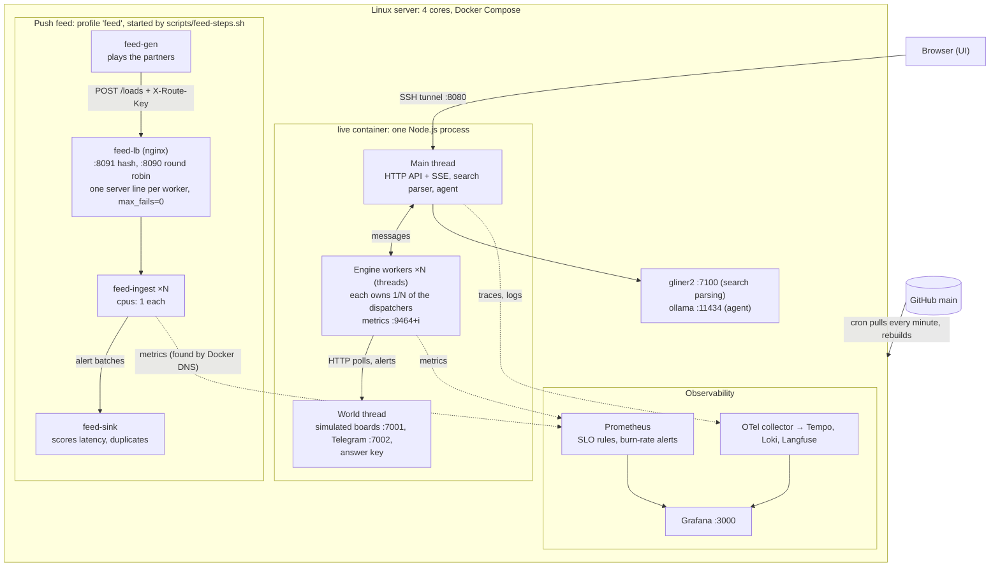

# Load Radar at 1000x

A saved-search alert engine for truck dispatchers, built and load-tested on simulated load boards, to answer one question with measurements: **what breaks first at 1000x, and how do you fix it?**

Status: updated 2026-11-04. Originally time-boxed to 2 days on one laptop; most of it is now built and running continuously on a server (section 8 below has the built-vs-designed checklist).

> New to the project? Start with [GUIDE.md](GUIDE.md); this document assumes its Parts 1–5.

This is the **high-level design**: the problem, the constraints, the parts and why each exists. The **low-level design** (types, in-memory state, APIs, algorithms, failure handling, tests) is in [LLD.md](LLD.md).

**Guiding rule:** connection pool limits and N+1 queries usually bite long before the database does. Fix those first, then talk Redis. So the hot path has **no shared store**: each stage keeps its state in memory, owned by one worker and partitioned by key. A shared store or log is added only when a measurement asks for it (LLD section 12).

---

## 1. The problem in one page

**The industry.** A *shipper* has goods to move. A *broker* takes the job and posts it as a *load* on a *load board* (DAT is the biggest, with ~500K load posts a day; then Truckstop, then broker portals). A *carrier* owns trucks. Its *dispatcher* keeps the trucks busy by finding loads.

**The pain.** When a truck goes empty in Chicago, the dispatcher searches every board for "van, within 50 miles of Chicago, at least $2.80/mile" and refreshes all day. Good loads are gone in minutes, so whoever sees one first gets it.

**The product.** The dispatcher saves a search once. The system watches every board and **alerts their phone the moment a matching load appears.** This project designs that system to scale.

**What the customer needs**, in priority order:

| Need | Measured as |
| --- | --- |
| Never get my board account banned | bans = 0 |
| Fast | seconds from *broker posted* to *alert on my phone* |
| Complete | share of matching loads never alerted |
| Quiet | duplicate alerts; alerts for loads already taken |

**Why it's a scaling problem.** New freight is small: a few loads a second. Checking for it is big, because each customer's searches run on **their own login**:

```
requests/s = dispatchers × board logins each × requests per login per second
   measured:   2,000     ×       1.8        ×   ~0.52                       = 1,882/s   (SLO.md, 1×)
   per dispatcher: ~0.94 requests/s (each login may poll once a second; merged queries and the
                   square-root rule spend that budget, quiet lanes are checked less)
   5,000 dispatchers                                                       ≈ 4,700/s
   × 1000 growth (5 million dispatchers)                                   ≈ 4.7 million/s
```

The first version of this line was a guess (5,000 × 4 searches × 4 boards ÷ 15 s ≈ 5,300/s). The measured rate is close,
for different reasons: dispatchers have ~1.8 board logins, not 4, but each login polls more often than every 15 s.

What that costs, from the scale tests (SLO.md): one engine worker serves ~2,000–3,000 requests/s within the SLOs, and 2
workers did 1.77× one. So 5,000 dispatchers is 2–3 workers (this 4-core server); 4.7 million/s would be ~2,000 workers,
about 125 machines of 16 cores. Moving volume to push feeds (fetched once for everyone, §3.5) is what bends that curve.

At 2,000 dispatchers and 100K loads/day, board requests outnumber new loads about **1,600 to 1** (1,882/s vs 1.2/s).
**The work is in polling, deduplicating and fanning out, not in the freight itself.**

## 2. Constraints that shape the design

| Constraint | Evidence | What it forces |
| --- | --- | --- |
| One login per person; no sharing, no scraping tools | [DAT](https://www.dat.com/blog/why-dat-doesnt-allow-login-sharing-or-data-scraping-extensions): "Each DAT login is for one person." Board tools in this market connect each customer's own account | A result fetched with customer A's login can **only alert customer A**. No cross-customer cache for gated boards |
| Different customers see different loads | Broker portals only show loads to approved carriers | Every posting carries **who is allowed to see it** |
| Each login has a request budget; abuse gets it banned | Board behavior (simulated) | The scheduler spends a per-login budget. A ban is the worst outcome |
| Telegram: ~30 msg/s per bot, ~1 msg/s per chat | [Telegram Bot FAQ](https://core.telegram.org/bots/faq) | 5,000 alerts for one hot load take ~170 s from one bot. Delivery is a bottleneck |
| ~52% of board rows are duplicates; loads are cross-posted, re-posted and co-brokered; 30% have no rate | Measured on a public board, built into the simulator (`sim/ASSUMPTIONS.md`) | Two-stage dedup; an explicit policy for loads with no rate |
| LLMs are slow (~1 s) and cost money | General | No LLM per posting. LLMs only when a search is created |

## 3. System design and architecture

Two views of the same system. The **system design** view is the logic: what happens to a posting, and the decisions
that shape it (no product names). The **architecture** view is what actually runs, where, and how the parts connect.

### System design: what happens and why

```mermaid
flowchart LR
  subgraph CP["Control plane: a dispatcher saves a search (rare, accuracy matters)"]
    U[Dispatcher] --> PARSE["Understand the search<br/>rules first, a model only if unsure;<br/>ask instead of guessing"]
    PARSE --> SEARCHES[(Saved searches)]
    SEARCHES --> PLAN["Plan the polling<br/>merge a dispatcher's overlapping searches;<br/>budget per login, busy lanes more often (√ rule)"]
    SEARCHES --> INDEX["Match index<br/>area × equipment → searches"]
  end

  subgraph POLL["Polling lane: boards that need each customer's own login<br/>split by DISPATCHER: everything about one dispatcher in one place, nothing shared"]
    SCHED["Decide when to check<br/>stay inside each login's budget;<br/>one request at a time per login; back off on 'slow down'"]
    FETCH["Fetch with the customer's login"]
    N1["Normalize<br/>one format; who may see it"]
    D1["Dedup<br/>same id, then 'same load?' model"]
    M1["Match<br/>only that customer's searches"]
  end

  subgraph PUSH["Push lane: partners send each load once, for everyone<br/>split by LOAD: every copy of a load to the same place, so dedup sees them all"]
    ROUTE["Route by lane key<br/>origin, destination, pickup date, equipment"]
    N2["Normalize"]
    D2["Dedup"]
    M2["Match<br/>every customer's searches"]
  end

  subgraph OUT["Alerts"]
    Q["Queue<br/>one alert per dispatcher per load;<br/>freshest first when behind, drop stale"]
    SEND["Deliver<br/>within each channel's limits; digests"]
  end

  PLAN --> SCHED --> FETCH --> N1 --> D1 --> M1 --> Q
  INDEX --> M1
  INDEX --> M2
  PARTNERS[Partners] --> ROUTE --> N2 --> D2 --> M2 --> Q
  Q --> SEND --> PHONE[Dispatcher]
  PHONE -->|"Should I take it?"| DECIDE["Decide<br/>a model reads the broker's comments;<br/>code applies the dispatch policy"]
```



### Architecture: what runs where



The detailed version of the live container, thread by thread, is next.

### 3.0 Live mode: the same pipeline, running continuously

The `live` service runs the system design above continuously, with a UI, instead of a batch run against a fixed
dataset. It's one container with **several threads**: the simulated outside world gets its own event loop and core, so
the engine doesn't share a CPU with the boards it polls, and with `--engine-workers N` (`LIVE_ENGINE_WORKERS`) the engine
itself runs as N threads, each owning 1/N of the dispatchers (default 0: the engine on the main thread).

```
┌─ live container: one Node process, 2 + N threads ─────────────────────────────────────────────────────────┐
│ WORLD THREAD  live/world-worker.ts  ("the outside world": its own event loop and core)                     │
│   sim/world.ts ─► live/stream.ts   new loads forever (Poisson, US Central hour of day); every refresh,      │
│                                    repost, cross-post and co-broker copy scheduled and released on time   │
│     ├─► boards-sim    :7001  per-login budgets, 429 + Retry-After, bans, loads covered after ~20 min      │
│     ├─► telegram-sim  :7002  30 msg/s per bot, 1 msg/s per chat                                           │
│     └─► live/score.ts        answer key built as each load is born; scores every delivery                 │
│              ▲ HTTP, exactly as to real boards                │ messages: stats, postings, your alerts,   │
│              │                                                ▼ load facts for the agent                  │
│ ENGINE WORKERS  live/engine-worker.ts ×N  (dispatchers split round robin; each worker owns its share's     │
│                 logins, rate limits, alerted memory and chats, and 4/N of the Telegram bots: nothing shared)│
│   src/engine.ts  scheduler (√ budgets, 1 request in flight per login, duplicate polls coalesced)          │
│                  ─► pollers ─► normalize ─► dedup (exact id, then logistic-regression classifier)          │
│                  ─► matcher (geohash index) ─► alert queue ─► notifier (digests; under backlog freshest    │
│                     first, stale dropped) ─► telegram-sim          metrics :9464, :9465, ... one per worker │
│ MAIN THREAD  live/server.ts  (runs the engine itself when N = 0)                                           │
│   HTTP + SSE  /api/state /api/events /api/searches /api/speed /api/rate /api/burst                         │
│               /api/parse ─► rules; GLiNER2 only if equipment/origin missing ─────────► gliner2 :7100       │
│               /api/agent ─► model reads broker comments, code applies the policy ────► ollama :11434       │
│   /metrics (answer-key counters for the SLOs)      :9464 (engine metrics)                                  │
└────────────────────────────────────────────────────────────────────────────────────────────────────────────┘
   ui/ (React + shadcn, static) ◄── browser, through the SSH tunnel on :8080

Push feed (docker compose profile "feed", run on demand by scripts/feed-steps.sh)
  feed-gen (plays the partners: the same world, one POST per posting, X-Route-Key = lane key)
     ─► feed-lb   nginx :8091 hash on X-Route-Key (one server line per worker, max_fails=0) · :8090 round robin
     ─► feed-ingest ×N   cpus: 1 each; normalize ─► dedup ─► match against every search ─► batches of alerts
     ─► feed-sink        stands in for push/Telegram; scores latency and duplicates against the generator's truth
  prometheus finds the ingest replicas through Docker DNS (dns_sd_configs)

Telemetry
  code ── OTLP ─► otel-collector :4318 ─┬─ traces ─────► tempo        every trace (Grafana: timelines)
                                         ├─ traces/genai ► langfuse     model calls, agent runs, tool calls
                                         ├─ traces/llm ──► spanmetrics ─► prometheus   llm_calls_total, llm_duration_*
                                         └─ logs ───────► loki         one JSON line per event, with trace_id
  prometheus scrapes live:9464 and live:8080/metrics; rules turn them into SLIs, error budgets and burn-rate alerts
  grafana :3000 reads prometheus, tempo and loki (linked by trace_id); langfuse :3001 has its own UI
```

Speed is adjustable while running (`src/shared/clock.ts`, `createAdjustableClock`): the UI's speed slider re-anchors sim time to real time on every change instead of restarting the process, and the new anchor is copied to the world thread so both threads keep one simulated time. Saving or removing a search calls `engine.refreshSearches()`, which rebuilds the matcher index and polling plans and cancels any alert still queued or held for a search that's gone (LLD §6.10).

`live/server.ts` also serves its own `/metrics` (separate from the engine's own `:9464`), exporting the live answer key as `answer_key_settled_total` / `answer_key_other_total`: that's what the SLOs in [SLO.md](SLO.md) and the dashboard's SLO row are built on.

### 3.1 Control plane: creating a search (rare, accuracy matters)

**Search parser.** It turns "need reefer out of Fresno paying 3.40, 100 mile radius" into fields: `equipment=reefer, origin=Fresno CA, deadhead=100, min_rpm=3.40, destination=anywhere`. This is extraction, not classification, and it runs once per search, so speed doesn't matter. The design is a cascade:

1. **Rules parser:** a town list, plus patterns for `$3.40`, `DH 100`, and equipment words. Instant and free, and handles clean input.
2. **LLM only when the rules aren't confident:** typos, slang, unusual phrasing. Structured output against a JSON schema.
3. **Validate, then confirm with the user:** "Reefer from within 100 mi of Fresno, CA, ≥ $3.40/mi. Correct?" A wrong filter means silently missed loads, so the user confirms.

**Plan compiler.** When searches change, it rebuilds two things:
- **The poll plan for each login.** It merges that customer's overlapping searches into the fewest board queries ("5 searches around Chicago" becomes one wider query, filtered locally) and estimates how busy each lane is.
- **The matcher index entries** for those searches.

### 3.2 Sources: two lanes

| Lane | Examples | Fetching | Who can be alerted |
| --- | --- | --- | --- |
| **Gated** | DAT, Truckstop, broker portals | with each customer's own login, within that login's budget | only that customer |
| **Shared** | loads brokers post directly, partner syndication feeds | once for everyone | every matching search |

Polling the gated lane is what explodes at scale. **Moving volume into the shared lane through partnerships is the strongest 1000x lever. It's a business fix, not a server fix.**

### 3.3 Data plane: every posting (hot path)

**Scheduler.** An in-memory min-heap keyed by "next check time," holding one entry per (login, query). For each entry it decides when to check next:
- **Budget:** never exceed the login's request allowance (token bucket per login).
- **Adaptive interval:** busy lanes every few seconds, quiet lanes every few minutes. The budget goes where new matches are most likely.
- **Jitter:** never fire everything at the same second.
- **Backoff and circuit breaker:** on a 429 (too many requests), back off exponentially. On repeated 429s, pause that login before the board bans it.

**Pollers.** A stateless worker pool that runs the board requests. It scales horizontally.

**Normalizer.** One adapter per board turns its format into one `Load` schema. The four simulated boards differ: `"V"` vs `"VAN"` vs `"Dry Van 53'"`; `"$0"` or `null` for no rate; city names cut at 14 characters; weight in thousands labeled "lbs". Each record also gets:
- coordinates, by looking the town up in the gazetteer
- a normalized equipment type
- **who may see it** (the login it came from, or "everyone" for shared feeds)

**Dedup.** Two stages:
1. **Exact, cheap:** `(board, board_load_id)` plus a content hash in a set that expires. This catches refreshes, the same posting seen again.
2. **Same-load classifier:** finds candidates that share pickup date, origin area, destination area and equipment. A small fast model (logistic regression or gradient boosting) scores whether two postings are the same load, using features like rate within 10%, posted within 2 hours, same broker, and town-name similarity. This catches **reposts with a new id, cross-posts on other boards, and co-brokered copies from a different broker.** It must **not** merge recurring loads on the same lane for different pickup days. The simulator's answer key provides labeled training pairs for free.

**Matcher.** An inverted index from `(origin cell, equipment, pickup date)` to candidate searches. Cells are geohash level 3 (about 117 × 157 km near Chicago), and each search is listed under every cell its deadhead circle touches: 6–20 cells per search, versus ~100–470 at level 4 (measured). A load is a point, so matching is one hash lookup plus exact distance checks. No range scan over latitude and longitude (see LLD 5.7). Then exact filters run on the candidates:
- deadhead distance
- destination
- rate floor
- **entitlement:** gated postings only match the searches of the customer whose login found them

**No-rate policy (30% of postings):** a search with a rate floor still gets these loads, marked "no rate posted, call to negotiate," unless the user turns that off. Dispatchers negotiate these all the time.

**Alert queue.** While delivery keeps up, oldest first, which minimizes the worst-case latency. When it falls behind, freshest first, because older loads are probably taken already. An alert older than its deadline (~10 min) is dropped and counted. An idempotency key `(user, load)` makes sure retries and duplicate postings never alert twice.

**Notifier.** Token buckets enforce ~30 msg/s per bot and ~1 msg/s per chat. When one chat has several pending alerts, they're merged into one digest. It supports several bots and channels (in-app push, Telegram, email).

### 3.4 One posting's journey

> 9:02:10. A broker posts a Chicago → Atlanta van load, $1,950, on DAT, picking up today.
>
> 1. **9:02:14:** the scheduler fires customer #318's merged "vans around Chicago" query (a busy lane, checked every ~5 s).
> 2. The poller gets DAT results. The normalizer turns `"CHICAGO HEIGHTS, IL"`, `"V"`, `1950` into a `Load` with coordinates, `equipment=van`, `visible_to=customer #318`.
> 3. **Dedup:** the board id is new. The classifier finds no earlier posting of this load, so it's new.
> 4. **Matcher:** cell `dp3w` + van + today gives 3 candidate searches from customer #318. Two pass the deadhead and rate filters.
> 5. **Queue:** one alert for customer #318 (the key is per user per load, so two matching searches still mean one alert).
> 6. **9:02:16:** the notifier sends it to Telegram. **Post-to-alert: 6 seconds.**
> 7. **9:03:40:** the same broker cross-posts on Truckstop at $1,975. Customer #318's Truckstop query finds it. The classifier says same load, so no second alert.

### 3.5 Scaling out: engine workers and the push feed (measured, SLO.md)

**Polling lane: shard by dispatcher.** `--engine-workers N` runs the engine as N threads, each owning 1/N of the
dispatchers with their logins, rate limits, "already alerted" memory and Telegram chats. Nothing is shared, so no
load balancer is needed: the work is polls the worker creates itself. Measured: a second worker gives 1.77x the board
requests on the same load (3,745 -> 6,617/s on the 4-core server).

**Push lane: a load balancer that routes by the load.** Partners push postings to nginx, which spreads them over N
ingest workers (one core each). Dedup memory lives in each worker, so nginx hashes on a lane key (origin state,
destination state, pickup date, equipment) that every copy of a load shares. Round robin is the wrong default here:
measured 43% duplicate alerts vs 2% with hash routing. Throughput 2,050 -> 3,346 postings/s from 1 to 3 workers.
Two nginx details matter for stateful routing: one `server` line per worker (a name resolving to several addresses
isn't hashed between them), and `max_fails=0` (otherwise one failed request moves a worker's loads elsewhere for 10 s).

## 4. Decisions, alternatives and trade-offs

Each row is a choice we made, what we compared it against, and what it costs us. [GUIDE.md §6](GUIDE.md#6-technology-and-why) has a plain-language summary.

| # | Decision | Why | Alternatives considered | Trade-off we accept |
| --- | --- | --- | --- | --- |
| 1 | **Poll gated boards with each customer's own login**, within a per-login budget | DAT: "Each DAT login is for one person"; customers see different loads (broker approvals, tiers) | One shared fetch cached for everyone | Request volume scales with customers × searches × boards; budgets become the main limit |
| 2 | **Two source lanes:** gated (per login) and shared (fetched once) | The only way to avoid per-login polling at 1000x | Polling only; scraping | Shared feeds need partnerships, a business task |
| 3 | **Merge each customer's searches** into the fewest board queries, filter locally | Fewer requests for the same budget (estimated 2–3×) | One query per search | More data per response to filter; local filtering CPU |
| 4 | **Budget allocation by the square-root rule** (`fᵢ ∝ √λᵢ`) | Minimizes average discovery delay under a fixed budget; quiet lanes still get checked | Equal intervals; proportional to rate | Exact only for steady random arrivals; real bursts need the backoff and stretch logic too |
| 5 | **Backoff and circuit breaker per login** before a ban | A suspended account is the worst customer outcome | Retry on failure | Slower discovery while a login is paused |
| 6 | **Two-stage dedup:** exact id + content hash, then a small trained classifier | Exact ids catch refreshes; only features catch reposts, cross-posts, co-brokers | Exact only (duplicates); rules only (measured 12% wrong merges) | Needs labeled pairs (the generator provides them); tuned to favor duplicates over hidden loads |
| 7 | **Entitlement on every posting** (`visibleTo`) | A load found with customer A's login may only alert customer A | Alert everyone who matches | Measured without it: ~244 users per load, 5.7M alerts a day; with it, alerts are realistic |
| 8 | **Matcher index on geohash level 3**, then exact distance checks | Measured 6–20 cells per search vs 99–474 at level 4; one hash lookup per load, no range scan | DB range query on lat/lon (slow); R-tree (for ad-hoc map queries, not point lookups); level 4 (index too big) | Some false candidates, removed by exact checks; S2 coverings would be tighter at production scale |
| 9 | **State in memory, partitioned by key; no Redis on the hot path** | No network call per load, so no N+1 or pool limits against a store; atomic updates for free | Redis between every stage (first draft) | A crash loses ≤ 5 s of state (snapshots); scaling out needs a log (Kafka), added only on a measured trigger |
| 10 | **At-least-once delivery + idempotency keys** `(user, load)` | Simple and safe: a repeat is harmless | Exactly-once machinery | Rare duplicate sends after a crash; measured by a kill-and-restart test |
| 11 | **Alert order:** oldest first while keeping up, freshest first when overloaded, drop after 10 min | Oldest-first minimizes worst-case wait; under overload, old loads are likely taken | Always FIFO; always LIFO | Some alerts are dropped on purpose (counted) |
| 12 | **LLM only on the cold path**, behind a rules parser, with user confirmation | ~1 s and a per-call cost are fine once per search, impossible per posting | LLM per posting; rules only | Messy searches need a confirmation step; an LLM outage only affects search creation |
| 13 | **Observability: lite metrics + our own 1% head sampling + 1 span per posting; slow or failed postings recorded after the fact** | Measured +1.0% CPU, vs +18% (default 1% tracing) and +41% with 3% span loss (default 100%) | Default OTel setup; collector tail sampling (needs 100% export) | Stage histograms from 1 in 16 postings; fewer traces kept; counters and post-to-alert latency stay exact |
| 14 | **Synthetic data calibrated to real numbers**, with an answer key | Boards forbid scraping; the answer key makes misses and latency measurable exactly | Scraped samples | Results depend on simulator assumptions (`sim/ASSUMPTIONS.md`, `sim/validate.ts`) |
| 15 | **Benchmarks on a pinned Linux core**, noise floor reported | Laptop noise (±10%) hides 5% effects; pinned: ±1.4% | Laptop runs | Needs a Linux machine (the `dev` server) |
| 16 | **TypeScript on Node** | One language for engine, simulators and UI; measured fast enough per posting | Go or Rust | One JS thread per process: worker threads and more processes needed sooner |
| 17 | **Live mode as one container, several threads**: the simulated world (stream, boards, Telegram, answer key) on a worker thread, the API on the main thread, the engine on the main thread or on N worker threads (#31) | The engine must not share a core with the boards it polls; the answer key must see both sides (loads born, alerts delivered) on one clock | One thread (first version: the boards stole the engine's CPU); separate processes per simulator, like batch mode | Message passing between threads, and the clock anchor copied on every speed change; still one process to restart |
| 18 | **Tempo + Loki, not Jaeger**, for traces and logs | Both are Grafana's own backends: one UI for metrics, traces and logs, linked (log → trace by `trace_id`, trace → logs, latency exemplars → trace). Tempo's `local-blocks` processor gives TraceQL rate/error/duration metrics with no separate query engine | Jaeger (own UI, no built-in log link); a hosted trace backend | One more self-hosted service (Loki) to run and keep healthy |
| 19 | **Pull-based continuous deploy** (cron runs `ops/server/deploy.sh` every minute: fetch, fast-forward, rebuild) over a self-hosted CI runner on this public repo | A self-hosted GitHub Actions runner on a public repo executes any PR's code; cron only ever reads `main` from GitHub, and the server accepts no inbound connections at all | Self-hosted Actions runner; a webhook-triggered deploy (needs an open port) | Up to a minute of deploy lag; no rollback button, just `git revert` and push |
| 20 | **Adjustable sim clock** (`createAdjustableClock`): speed can change mid-run, re-anchoring sim time to real time | The live UI's speed slider must not make `now()` jump when the user drags it | A fixed-speed clock, restarted to change speed (what batch mode uses) | A little extra bookkeeping (re-anchor on every speed change) instead of a single multiply |
| 21 | **SLOs first** (alerts within 60 s, matching loads alerted, no bans), with 1-hour error budgets and multi-window burn-rate alerts (SLO.md) | Every later change is judged by a number the dispatcher would care about; burn rates page on real trouble, not on one slow minute | Alert on raw thresholds (p95 > X); no targets | Targets are our guess at what dispatchers need; a 1-hour window because the live world restarts on every deploy (production would use 28–30 days) |
| 22 | **Overload rules for polling:** a poll still queued or running is never queued again (coalesced); at most one request in flight per login | A poll asks "new since my cursor", so a copy fetches nothing; pausing a login after a 429 only works if nothing else is on the wire for it (the 120× ban storm: 541/548 logins) | Queue every poll (first version); only a global concurrency cap | A login's throughput is capped at 1 ÷ request latency; at 30× speed, completeness fell (92.3% → 87.9%) while speed rose (48.8% → 83.7% within 60 s) |
| 23 | **Alert backlog rules:** freshest first, alerts older than 10 min dropped, digests of 20 instead of 5, a cap per chat | Under backlog, an old load is probably taken; on time or not at all | FIFO until the backlog clears | Some alerts are dropped on purpose (counted as `notifier_dropped_stale`) |
| 24 | **Dedup model: logistic regression**, scored in TypeScript, parity with Python checked at startup | 18 multiply-adds (~130 ns/pair), readable weights, no Python or native library in the engine; recall 99.4% vs LightGBM's 99.9% (ML.md) | LightGBM (needs a tree runtime or ONNX); the hand-written rule (1,806 wrong merges vs 27) | Slightly more duplicates than LightGBM; features must stay identical in training and serving (one `pairFeatures()` for both) |
| 25 | **Dedup threshold at precision ≥ 0.995**, chosen on a time-split validation set | A wrong merge hides a real load from every dispatcher; a missed merge is one duplicate alert | Threshold 0.5; best F1 | More duplicates than a recall-maximizing threshold |
| 26 | **Load decision: the model reads language, code applies the policy** ("split" design) | Measured: a small model doing the whole decision was right 29–50% of the time; the same model only reading the broker's comments, 94% on messy wording (vs 56% for keywords), 1 short call | A full tool-calling agent (more autonomous, slower, invents numbers); keywords only | Needs the policy written down; the model's job is narrow, by design |
| 27 | **Local models only** (Ollama, Qwen 2.5, on CPU) | Free, private, no API keys; the evals show what each size can and can't do | A hosted LLM API (faster, stronger) | Slow on this CPU (seconds to minutes per call), weaker models; the design keeps model calls off the hot path |
| 28 | **SSE to the browser**, POST for commands | Data flows server → page; SSE is plain HTTP and reconnects by itself | WebSockets (two-way, not needed); polling from the page | No resume after reconnect yet (`Last-Event-ID`); one connection per tab |
| 29 | **Bounded in-memory queues between stages now, a stream (Kafka/Redpanda) later** | One machine, the bottleneck is CPU and login budgets, not moving data; a stream adds a hop, disk and a service to run | A stream from day one | A restart loses what's in the queues; the switch is planned for when stages span machines (LLD §12) |
| 30 | **Dashboards, alert rules and data sources as code** (`ops/grafana/`, `ops/prometheus-rules.yml`) | Reviewed in git, deployed with everything else, rebuilt identically on a new server | Clicking them together in the Grafana UI | Edits made in the UI are overwritten on restart |
| 31 | **Engine workers sharded by dispatcher** (`--engine-workers N`, threads in one process) | A dispatcher's logins, rate limits, "already alerted" memory and chats all live in one worker, so workers share nothing and need no load balancer: the work is polls each worker creates. Measured 1.77× board requests with 2 workers (SLO.md) | Shard by board (a dispatcher's alerts split across workers, which must then coordinate); processes per worker | One process still restarts as a whole; across machines, ownership needs leases (LLD §12) |
| 32 | **Push feed: nginx hashing on a lane key** (origin state, destination state, pickup date, equipment) | Dedup memory is per worker, so every copy of a load must reach the same worker. Measured: round robin 43% duplicate alerts, hash 2% | Round robin (breaks dedup); a shared dedup store (a network call per posting) | Uneven load if a few lanes are hot; partners don't send our key, so in production an edge tier or Kafka's partition key computes it |
| 33 | **`max_fails=0` and a 65 s worker keep-alive behind nginx** | nginx's default takes a worker out for 10 s after one failed request and re-hashes its loads elsewhere; Node's 5 s keep-alive caused the failures. Measured 14.5% → 2% duplicates | Defaults; health checks (nginx Plus) | A worker that's really down is not skipped: its share fails until it's back or removed from the list |

## 5. What breaks first at 1000x (hypotheses the load test will confirm or correct)

| # | Breaks | Why | Fix |
| --- | --- | --- | --- |
| 1 | **Login budgets** (outside our servers) | Per-login rate limits cap check frequency long before our CPU does | Merge queries better; adaptive intervals; **move volume to shared and partner feeds** |
| 2 | **Alert delivery** | A hot load matching thousands of users means minutes of queueing at 30 msg/s | Prioritize by load age; digests; several bots; in-app push as the main channel |
| 3 | **HTTP pools to the boards** (if undersized) | Requests wait inside our HTTP client; data gets stale with no errors. Sockets needed = request rate × response time | Size pools by Little's law; alert on pool wait time; never one extra request per load (no N+1 to board APIs) |
| 3b | **One CPU core** (event-loop lag) | Parsing board responses; millions of schedule entries | Worker threads partitioned by login; then more machines owning partitions |
| 4 | **In-memory state and GC** | Dedup and alerted sets grow with postings × logins; big heaps mean long GC pauses | Compact entries, drop whole hourly buckets, partition by key across workers and machines |
| 5 | **Matcher on hot cells** | Chicago or Dallas vans concentrate shared-feed fan-out | Shard by `(cell, equipment)`; dedicated workers for hot cells |
| 6 | **Login storage** (security, not throughput) | Thousands of customers' board passwords are the most sensitive data in the system | Encryption keys in a KMS, per-tenant isolation, audit logs |

### Scaling path

| Stage | Example size | Runs as | Next limit | Response |
| --- | --- | --- | --- | --- |
| Today (measured, SLO.md) | 2,000 dispatchers (3,600 logins) within all SLOs on one engine thread; the speed SLO breaks at 5,000. With 2 engine workers: 1.77x the board requests (6,617/s) | Engine workers (threads), each owning a share of the dispatchers; the simulated world on its own thread | The 4-core machine (the simulator shares it) | Workers on more machines, with leases for login ownership |
| 10x | ~50,000 customers | + worker threads partitioned by login | One CPU core (JSON parsing of responses) | Threads, then processes |
| 100x | ~500,000 customers | Several machines, each owning partitions (login / cell / user) | Telegram delivery; memory per machine | Push as main channel, more bots; compact state |
| 1000x | ~5M customers | Many machines, partitions connected by Kafka; snapshots + log replay | Login budgets as a business limit | Shared and partner feeds wherever possible |

No central store sits on the hot path at any stage; LLD section 12 lists the measured triggers for adding one.

**Measured, not just hypothesized, before 10x:** pushing live mode (one process) to 120× speed and 100K loads/day banned 541 of 548 logins and missed 86.6% of loads. Cause: the scheduler fires each login's next poll on a timer without checking whether that login's previous poll already got a response, so at high speed hundreds of requests for one login can be in flight before the first 429 comes back. Fixed: at most one poll in flight per login and duplicate polls coalesced (`src/engine.ts`); before/after in SLO.md.

## 6. Observability

The full plan (latency breakdown, RED/USE metrics, sampling, dashboards, burn-rate alerts, runbooks, load-test protocol) is in [OBSERVABILITY.md](OBSERVABILITY.md).

**Measured cost:** with lite metrics, our own 1% sampling and one span per posting, observability adds **+1.0% CPU** (pinned Linux core, 5 runs per mode; [bench/overhead/RESULTS.md](bench/overhead/RESULTS.md)). The default OpenTelemetry setup cost +18% at 1% and +41% at 100%, and lost 3% of spans.

Summary:

**Traces** (OpenTelemetry → Tempo, read from Grafana): 1% of postings, plus every slow or failed one, each as **one span** carrying the timing of every stage and the board's `posted_at`, so the 6 seconds above can be split by stage.

**Metrics** (Prometheus → Grafana, one dashboard):

| Metric | Answers |
| --- | --- |
| `post_to_alert_seconds` (histogram) + SLO burn rate | Are we fast? |
| `upstream_requests_total{board,status}`, `login_budget_remaining`, `login_paused_total` | Are we about to get a customer banned? |
| `poll_freshness_seconds{lane_heat}` | How stale is what we know? |
| `dedup_total{stage,result}` | How much duplication, caught where? |
| `match_fanout` (histogram) | Are hot cells overloading us? |
| `alert_queue_depth`, `alert_queue_oldest_seconds`, `alerts_dropped_stale_total` | Is delivery keeping up? |

**LLM call log:** for every parser call, the prompt, model, output, tokens, latency, cost, and whether the output passed validation.

**Ground truth.** The simulator knows when each load was really posted and which searches should have matched. That lets the scorer measure **latency, misses and duplicates exactly**, which a production system can only estimate.

**SLOs: built, with real error budgets and burn-rate alerts.** [SLO.md](SLO.md) is now the source of truth:

| SLI | Target |
| --- | --- |
| Alerts are fast | 99% of alerts reach Telegram within 60 s (simulated) of the load being posted |
| Alerts are complete | 99% of matching loads that stay on the board 5+ minutes get an alert |
| Boards stay friendly | 0 banned logins; under 1% of board requests answered 429 |

Each has a rolling 1-hour error budget and multiwindow burn-rate alerts (`ops/prometheus-rules.yml`), visible on the dashboard's **SLOs** row and at `/alerts` in Prometheus. Parser accuracy (valid on first try) is tracked separately by the eval set (`ml/parser/RESULTS.md`), not yet as a burn-rate SLO.

## 7. Test setup

| Piece | Status | What it does |
| --- | --- | --- |
| **Data generator** (`sim/gen.ts`) | Done | Realistic loads, postings in 4 board formats, users and searches, plus an answer key. Calibrated to DAT 2026 data and a public board sample; `sim/validate.ts` checks 16 metrics |
| **Observability overhead bench** (`bench/overhead/`) | Done | Engine core + 9 observability modes, run pinned on Linux; result +1.0% for the chosen setup |
| **Board simulator** (`sims/boards-sim.ts`) | Done | Serves postings over HTTP per login, enforces budgets (429s, bans), removes loads once they're taken |
| **Scorer** (`scorer/score.ts`, and `live/score.ts` for the always-on version) | Done | Compares delivered alerts to the answer key: latency, misses, duplicates, stale alerts |
| **Load test runs** | Informal, no dedicated suite | Live mode's speed slider, freight-volume buttons and burst button stand in for a step-load harness; pushing them to 120×/100K loads/day found the scheduler bug in section 5. The staged `users ×1, 2, 4, 8…` runs below aren't built as a separate script |

Each run records the first SLO to fail and what saturated at that moment: HTTP pool wait, CPU and event-loop lag, heap and GC, queue age, or token buckets.

## 8. Build plan

**Day 1: the pipeline runs end to end**
- [x] Data generator + validation
- [x] Engine core for the benchmark (normalize, dedup with a simple rule, matcher, alerts) + observability overhead test
- [x] `docker compose`: OTel Collector, Tempo, Loki, Prometheus, Grafana, GLiNER2, Ollama, Langfuse (self-hosted); runs continuously on the dev server, deployed by cron (DEPLOY.md), not just started locally
- [x] Board simulator (budgets, 429s, bans, covered loads) and Telegram simulator
- [x] Scheduler + pollers, normalizer, dedup (rule on Day 1; trained classifier since Day 2), matcher, alert queue, notifier
- [x] Observability on every stage (lite metrics, own 1% sampling, 1 span per posting) and an end-to-end scored run (README "History: the first end-to-end run")

**Day 2: AI/ML and measurement** (focus: AI/ML + backend/infra)
- [x] Same-load classifier trained on generator pairs: precision/recall, threshold choice, measured effect on misses and duplicates ([ML.md](ML.md), [ml/dedup/RESULTS.md](ml/dedup/RESULTS.md))
- [x] Search parser (rules + GLiNER2 / Qwen fallback), 40-example eval set, five contenders compared (ml/parser/RESULTS.md); one known disambiguation bug left open (GUIDE.md §11)
- [x] LLM observability: OpenTelemetry GenAI spans → self-hosted Langfuse + Tempo (traces) + Loki (logs) + Prometheus span metrics; eval scores attached to each call (OBSERVABILITY.md §8b)
- [x] Grafana dashboard (`ops/grafana/dashboards/load-radar.json`, provisioned as code) and scorer (batch + the live, rolling version in `live/score.ts`)
- [ ] Formal load-test harness (step-load runs); live mode's controls stood in instead and found the scheduler bug above
- [ ] `SCALING.md`: section 5 rewritten with measured numbers
- [x] README and GUIDE.md (plain-language guide, from zero)
- [ ] 2-minute video

**Built after the original 2-day plan:**
- [x] Live mode (`live/`, `ui/`): an always-on world, UI and rolling scorer, replacing a one-shot batch run as the main demo
- [x] Continuous deployment to a persistent Linux server, instead of a laptop-only demo (DEPLOY.md)

**Cut if behind, in this order:** LLM fallback (keep the rules parser) → classifier (keep exact dedup plus a simple fingerprint) → LLM-down run. **Never cut:** the scorer, the dashboard, the scaling write-up.

**Stack:** TypeScript on Node. One engine process with in-memory, partitioned state. Searches and credentials currently come from flat files, not a database: `searches.ndjson` in batch mode, a JSON file per user in live mode (volume `live_state`); no snapshot-to-disk recovery is built yet, so a crash loses all in-memory state, not just a few seconds of it. No Redis or Kafka until a measured trigger (LLD section 12); `SCALING.md` will say which trigger fired first. Section 13 of LLD.md describes where a real database (Postgres) and snapshot/log replay would go in production.

## 9. Risks

- **Laptop numbers aren't production numbers.** Report which stage saturates first and how the system degrades, not absolute capacity.
- **Results are only as good as the simulator.** Every assumption is listed in `sim/ASSUMPTIONS.md` so it can be challenged.

## 10. Open questions (answers would change the design)

- Is a product like this bound by polling on customer logins, or can it get push feeds from boards and brokers?
- What post-to-alert latency do dispatchers actually need, and how often do real systems miss matches?
- What do board partnerships allow that a normal login doesn't (higher limits, shared feeds)?
- Which channel do dispatchers act on fastest: push, Telegram or SMS?
